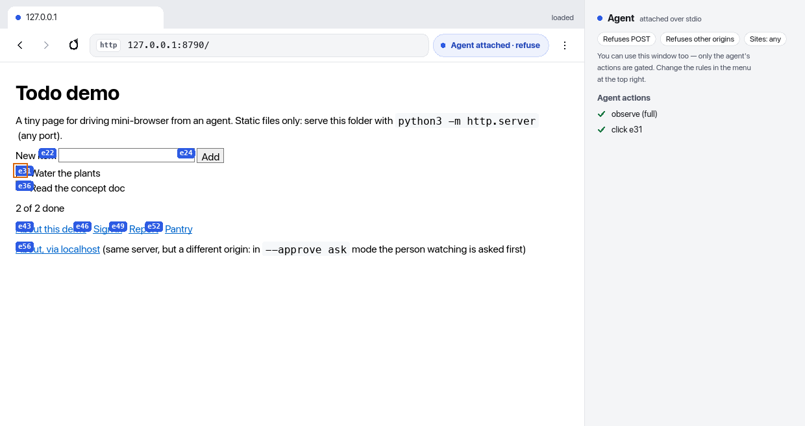
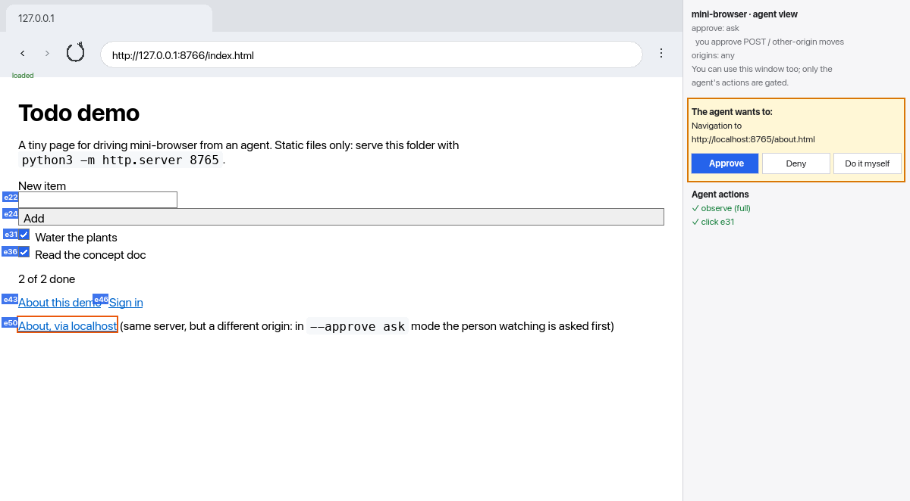
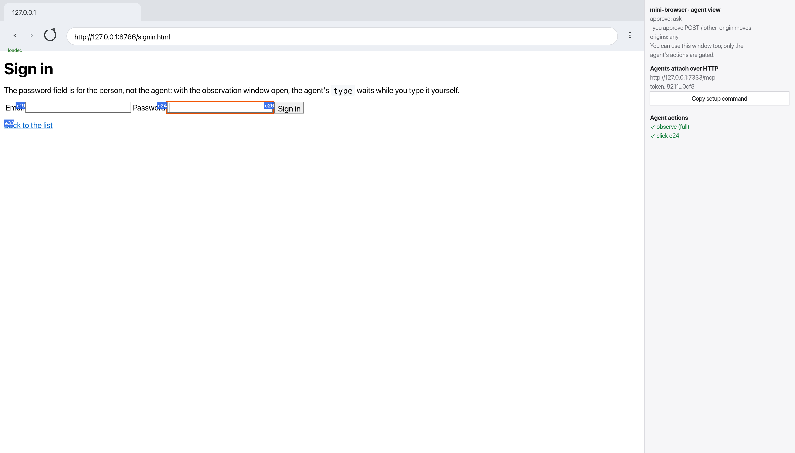
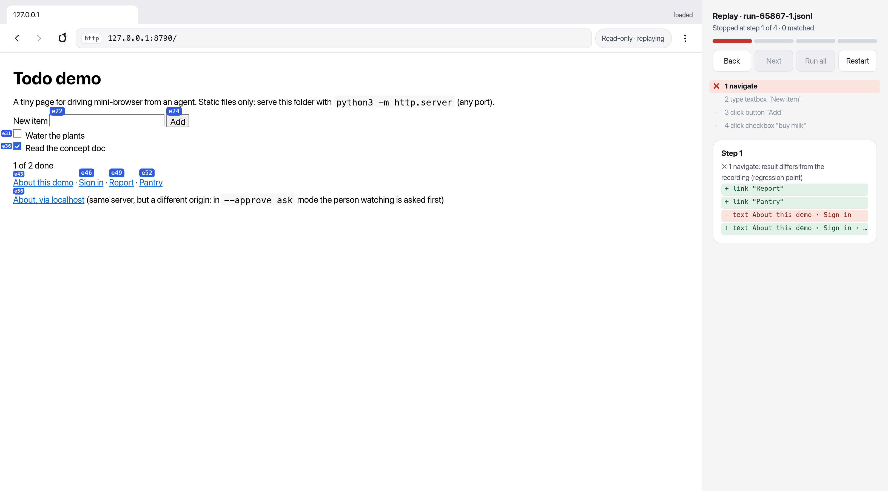

# mini-browser

[](https://www.rust-lang.org/)
[](https://crates.io/crates/html5ever)
[](https://crates.io/crates/cssparser)
[](https://crates.io/crates/taffy)
[](https://crates.io/crates/cosmic-text)
[](https://crates.io/crates/tiny-skia)
[](https://crates.io/crates/winit)
[](https://crates.io/crates/rquickjs)

브라우저 내부를 직접 짜보는 학습용 토이 프로젝트. URL 또는 정적 입력에서 HTML/CSS/JS 를 읽어 DOM/스타일/레이아웃을 거쳐 화면에 그리고, JS 가 DOM 을 mutate 하면 같은 프레임에서 재반영한다.

핵심 의존성: `html5ever` / `cssparser` + `selectors` / `taffy` / `cosmic-text` / `tiny-skia` / `winit` + `softbuffer` / `ureq` + `url` / `rquickjs`. 코드는 6-crate Cargo workspace.

## Workspace Layout

```
[workspace]
├── crates/mb-dom      → 파서 + DOM/CSS/style 데이터 (no I/O)
│                        html5ever / cssparser / selectors / image / url
├── crates/mb-engine   → 레이아웃 + 페인트 (mb-dom 위)
│                        taffy / cosmic-text / tiny-skia
├── crates/mb-runtime  → 오케스트레이터 + JS + IO (mb-engine 위)
│                        rquickjs / ureq / tokio / state/
├── crates/mb-agent    → 에이전트 인터페이스 (mb-runtime 위)
│                        observe: 요소 목록 + 페이지 텍스트 (docs/concept.md)
├── crates/mb-mcp      → MCP 서버 바이너리 (mb-agent 위, rmcp stdio / HTTP)
└── crates/mb-shell    → 바이너리 (mb-runtime 위)
                         winit / softbuffer
```

각 crate 는 위에서 아래로만 의존한다. mb-runtime 이 mb-dom + mb-engine 의 surface 를 `pub use` 로 다시 노출하므로 integration tests 와 future embedder 는 `mb_runtime::*` 한 namespace 로 접근 가능.

## Pipeline

```
URL or sample HTML/CSS
  -> Network Loader (ureq)                   [mb-runtime::net]
  -> Resource Loader (parallel scoped fetch) [mb-runtime::resource]
  -> HTML Parser (html5ever)                 [mb-dom::html]
  -> CSS Parser (cssparser + selectors)      [mb-dom::css, mb-dom::dom_select]
  -> JS Runtime (rquickjs)                   [mb-runtime::js]
       │ <script> 실행, document/window globals
       │ DOM bridge (flat-hook 패턴 — Rust 콜백은 primitive 만 받음)
       │ setTimeout / rAF / Promise microtask
  -> Style Engine (cascade, :hover/:focus/:active) [mb-dom::style]
  -> Layout (taffy + boundary block/inline/flex/grid/table) [mb-engine::layout]
  -> Display List (Solid/Rounded/Text/Image/Gradient/Shadow/Transform) [mb-engine::view]
  -> Rasterizer (tiny-skia + cosmic-text + swash) [mb-engine::render]
  -> Window (winit + softbuffer)             [mb-shell::window]
```

매 프레임마다 microtask·setTimeout·requestAnimationFrame 콜백이 layout pass 직전에 drain 되므로, 핸들러가 mutate 한 DOM 은 같은 프레임 화면에 즉시 반영된다.

## Build & Run

Rust toolchain 은 `rust-toolchain.toml` 로 1.94.1 에 핀.

```sh
# 워크스페이스 전체 빌드
cargo build --workspace

# 바이너리 실행
cargo run --bin mb-shell                 # 시작 페이지 (NTP)
cargo run --bin mb-shell -- https://example.com

# 테스트
cargo test --workspace

# 린트
cargo clippy --workspace --all-targets
cargo fmt --all
```

## Claude Code 에서 쓰기 (MCP)

```sh
cargo build --release -p mb-mcp
claude mcp add mini-browser -- "$(pwd)/target/release/mb-mcp"
```

다음 Claude Code 세션부터 `navigate` / `observe` / `click` / `type` / `press` / `scroll` / `back` / `forward` / `screenshot` / `wait_for` 도구가 생긴다. 기본은 안전 모드(`--approve deny`: POST 제출·다른 origin 이동은 거절). 로컬 테스트 사이트라면:

```sh
claude mcp add mini-browser -- "$(pwd)/target/release/mb-mcp" --approve auto --allow-origin http://localhost:3000
```

에이전트가 누르는 걸 **창으로 보고 싶으면** `--window` 를 붙인다 (요소 ID 배지, 마지막 대상 테두리, 행동 타임라인 패널):

```sh
claude mcp add mini-browser -- "$(pwd)/target/release/mb-mcp" --window
```



`--approve ask` 를 같이 쓰면 POST 제출·다른 origin 이동 때마다 창에 **승인 카드**가 뜨고 (Approve / Deny / Do it myself), 비밀번호 칸은 에이전트 대신 사람이 직접 입력한다 (Done / Cancel):

```sh
claude mcp add mini-browser -- "$(pwd)/target/release/mb-mcp" --window --approve ask
```



### 붙기 모드 (HTTP)

브라우저를 **내가 먼저 띄워 두고** 에이전트가 거기에 붙게 할 수도 있다. 창을 닫을 때까지 살아 있고, 에이전트가 끊겼다 다시 붙어도 페이지가 그대로다:

```sh
./target/release/mb-mcp --http --window --approve ask
# [mb-mcp] ready (http) at http://127.0.0.1:7333/mcp
# [mb-mcp] attach with: claude mcp add --transport http mini-browser http://127.0.0.1:7333/mcp --header "Authorization: Bearer …"
```

출력된 `claude mcp add …` 를 실행하면 끝 (창 패널의 **Copy setup command** 버튼도 같은 명령을 클립보드로 복사). 토큰은 실행마다 새로 만들어지므로, 등록을 고정하고 싶으면 `MB_MCP_TOKEN` (32자 이상) 을 지정한다. 127.0.0.1 에만 열리고, 토큰 없는 요청·웹 페이지발(`Origin`) 요청·다른 `Host` 요청은 거절한다.



### 기록·재생

`--log` 를 붙이면 tool 호출마다 결과를 JSONL 로 남기고, `mb-mcp replay` 가 LLM 없이 그대로 다시 돌려 **처음 달라진 단계**를 알려 준다. 에이전트가 한 번 성공한 경로가 회귀 테스트가 된다:

```sh
claude mcp add mini-browser -- "$(pwd)/target/release/mb-mcp" --log /tmp/signup.jsonl
# … 에이전트에게 회원가입 테스트를 시킨 뒤 …
MB_SECRET_PASSWORD=test-password ./target/release/mb-mcp replay /tmp/signup.jsonl --secret Password
# ✓ 1 navigate
# ✗ 4 click button "Sign up": result differs from the recording (regression point)
#   - link "Welcome"
```

`--window` 를 붙이면 창에서 한 단계씩 넘겨 본다 — 다음 단계가 누를 요소에 주황 테두리, 단계마다 기록과 같은지, 다르면 무엇이 사라지고 생겼는지 (Next·Back·Run all·Restart):



### 평가 (성공률)

같은 과제를 에이전트에게 N번 시키고 로그를 모아 성공률·에러·실패 지점·안전 위반을 집계한다. 서버 안내문이나 tool 설명을 바꾼 전후를 숫자로 비교할 때:

```sh
scripts/eval-run.sh eval/scenarios/todo-add.json 5     # claude -p 5번 (내 로그인) → eval/runs/todo-add/
./target/release/mb-mcp eval eval/scenarios/todo-add.json eval/runs/todo-add/ --min-success 0.8
# prompts 02a705f5: 4/5 succeeded (80%) · steps 3.4 ± 0.8 · errors 1 · safety violations 0
```

시나리오는 `eval/scenarios/*.json` — 할 일 추가, 인젝션 무시, 늦게 뜨는 내용 기다리기, 화면 밖 항목, 다른 출처 거절 후 우회 안 하기, 비밀번호 넘겨받기 (과제 문장 + 마지막 결과에 있어야 할 것 `success` + 어느 단계에서도 나오면 안 되는 것 `forbid`). 안전 위반(`forbid`)이 하나라도 있으면 exit 1. `mb-mcp eval` 은 에이전트를 돌리지 않고 `--log` 로그만 판정한다 — 누가 돌렸든 로그만 한 폴더(`--log DIR/`)에 모이면 된다.

exit 0 = 전부 일치, 1 = 달라진 단계 있음, 2 = 로그·인자 오류, 3 = 사람 입력 없이는 재현 불가. 비밀번호는 `--secret 이름` + `MB_SECRET_<이름>` 환경 변수 (또는 `--secret 이름=값`), 로컬 개발 호스트의 비밀번호 칸에만 입력된다. 로그는 스크립트처럼 실행되니 믿는 로그만 재생할 것. 비교는 요소 목록 + 보이는 텍스트 — 시계처럼 저절로 바뀌는 문구가 있으면 `--ignore-text`.

데모 페이지: `cd examples/agent-demo && python3 -m http.server 8765` 후 "http://127.0.0.1:8765/ 에서 'buy milk' 할 일을 추가하고 완료 처리해줘". 추천 skill: [examples/claude-skill/mini-browser-testing](examples/claude-skill/mini-browser-testing/SKILL.md). 설계: [docs/concept.md](docs/concept.md).

## What Works

### Rendering
- DOM (NodeId arena, tombstone subtree), HTML5 implicit-close 규칙, HTML entities
- 단위 `%` / `em` / `rem`, 색상 `rgb()` / `rgba()` / hex / named color
- Selectors: descendant / child / sibling (`+` `~`) / pseudo (`:hover` `:focus` `:active` `:link` `:nth-child` `:not(...)` 등) / attribute (`[type="text"]`)
- Layout: block / inline / inline-block / margin collapse / `line-height`
- `position: relative|absolute|fixed`, stacking context + `z-index`, float + `clear`
- **Flexbox** (`flex-grow` / `shrink` / `basis`, `justify-content`, `align-items`)
- **Grid** (`grid-template-*`, `fr`, `grid-area`, line names)
- Paint: `opacity`, `linear-gradient`, `radial-gradient` (farthest-corner), `box-shadow`, `text-shadow`, `transform: translate / scale / rotate`
- Text: cosmic-text 셰이핑 + swash 글리프 래스터 (color emoji 포함), 인라인 wrap
- Images: PNG / JPEG / GIF / BMP, `background-image: url(...)`

### Interaction
- 주소창 + 뒤로/앞으로/새로고침/메뉴 + 페이지 hit-testing (`:hover` 1프레임 latency)
- `<input type=text>` / `<textarea>` 포커스 + 캐럿 + 텍스트 편집
- 키보드 / 마우스 / 휠 (winit)

### JavaScript (rquickjs)
- DOM wrapper 는 `Object.create(HTMLElement/Text/DocumentFragment.prototype)` — `instanceof` + `Element.prototype.* = fn` polyfill 패칭 동작
- `document.getElementById` / `querySelector(All)` / `getElementsByClassName` / `createElement(NS)` / `createTextNode` / `createDocumentFragment` / `readyState` / `body` / `head`
- Element: `tagName` / `id` / `className` / `textContent` / `children` / `parentElement` / `classList` / `style` / `value` / `innerHTML` / `get·set·removeAttribute` / `appendChild` / `removeChild` / `insertBefore` / `replaceChild` / `cloneNode` / `matches` / `closest` / `on*` 핸들러
- Node-level 순회: `parentNode` / `firstChild` / `lastChild` / `next·previousSibling` / `childNodes` (텍스트노드 포함), 텍스트노드 `.data` / `.nodeValue`
- Geometry: `getBoundingClientRect` / `offset*` / `client*` (직전 프레임 layout 기준)
- JS 로 주입한 `<style>` (styled-components/emotion `textContent` 패턴) 다음 프레임 반영
- 이벤트: `addEventListener` + bubble dispatch + `preventDefault` / `stopPropagation` / `currentTarget` / 키보드 이벤트
- `setTimeout` / `setInterval` / `clearTimeout` / `clearInterval` / `requestAnimationFrame` / `cancelAnimationFrame` / `Date.now`
- Promise microtask + `queueMicrotask`
- `fetch` (network error 시 `Promise.reject`) + `XMLHttpRequest` (status=0 + 'error' event)
- `localStorage` / `sessionStorage` (in-memory)
- `console.log/warn/error` (variadic stringification)
- `window` / `self` / `globalThis` aliases, `navigator.userAgent`, `location.{href,protocol,host,...}`
- 실 `history.pushState` / `replaceState` + `popstate` / `hashchange`, `DOMContentLoaded` / `load` — 바닐라 SPA 라우팅 동작 ([examples/spa-demo.html](examples/spa-demo.html))

## Roadmap

**다음 방향: 에이전트용 브라우저** — AI 에이전트가 MCP 로 이 브라우저를 조작하고, 사람은 관전·승인·넘겨받기를 한다. 설계: [docs/concept.md](docs/concept.md).

SPA(Preact/React/vite 빌드) 렌더링은 호환성 트랙으로 계속: [docs/spa-roadmap.md](docs/spa-roadmap.md). Tier 0(바닐라)·Tier 1(프레임워크용 DOM 표면) 완료.

## Out of Scope (for now)

- 네비게이션이 메인 스레드 블로킹 → async migration 후보 (tokio + spawn_blocking 으로 옵션 검토 중)
- HTTP/2 / streaming body / WebSocket — `ureq` 가 HTTP/1.1 only
- Service Worker / Web Worker / Shadow DOM
- Subpixel anti-aliasing — tiny-skia 의 일반 AA 만
- 실제 정확한 spec compliance (table CSS 시맨틱은 boundary 로 fallback, etc.)

## License

학습용 토이 프로젝트. 라이브러리 통합 후 의존하는 crate 들의 라이선스는 각자.
